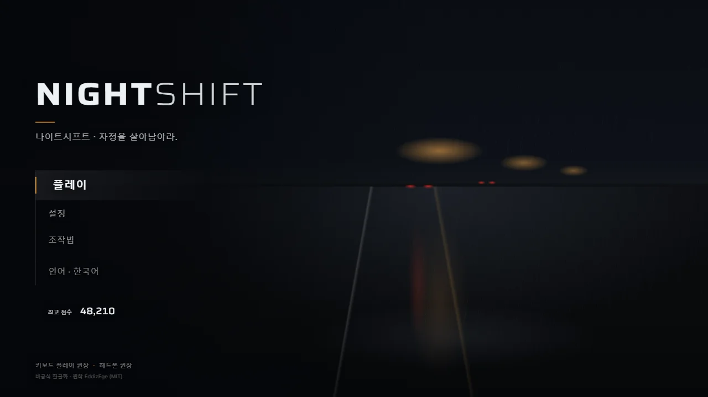
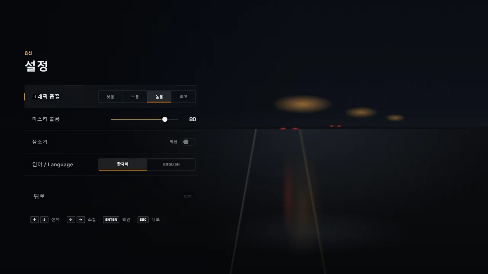
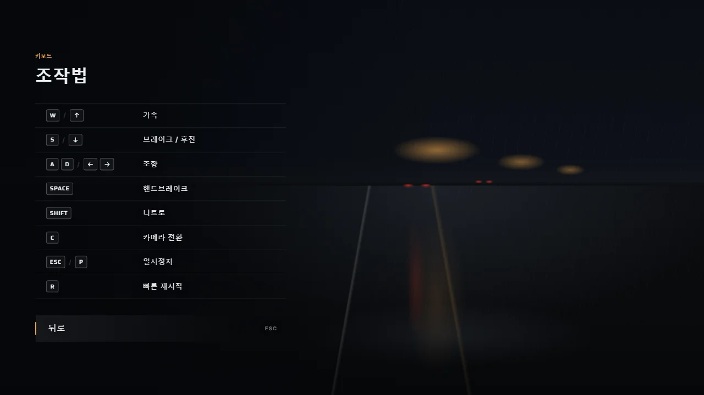
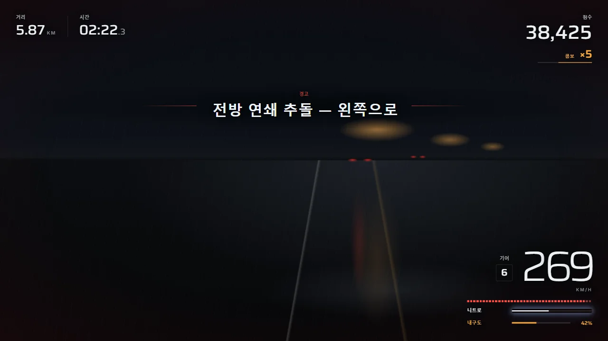
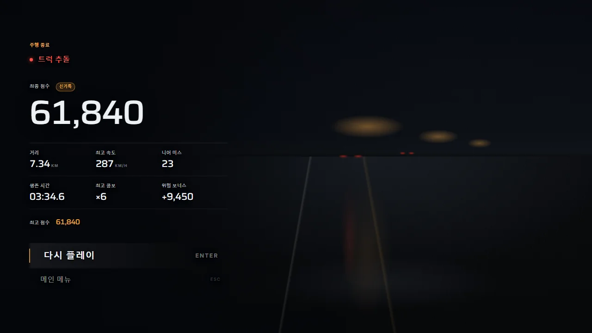
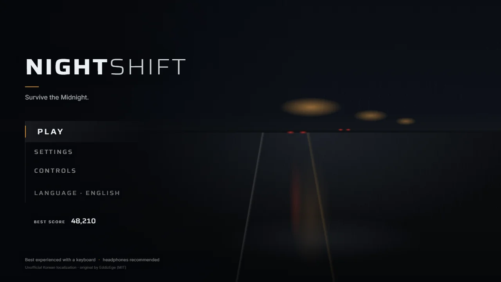
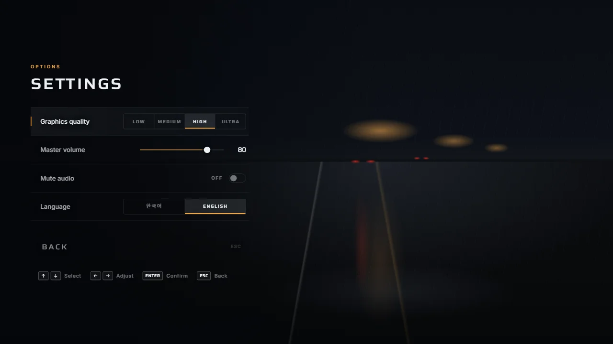

# NIGHTSHIFT 나이트시프트 — 한글화

비 오는 밤 고속도로를 달리는 시네마틱 레이싱 게임 **NIGHTSHIFT: Survive the Midnight**(자정을 살아남아라)의 비공식 한글화입니다.

- 플레이: https://sigco3111.github.io/nightshift-ko/
- UI만 미리보기(WebGL 불필요): https://sigco3111.github.io/nightshift-ko/ui-preview.html?state=menu (`state` = `menu` `settings` `controls` `hud` `hudbusy` `pause` `gameover` `intro` `loading`)

> **WebGL2 지원 GPU 환경에서 플레이하세요.** (키보드 필수, 헤드폰 권장. GPU 가속이 없는 환경에서는 셰이더 예열 단계에서 멈출 수 있습니다.)

## 언어

기본 언어는 한국어이며 영어도 유지됩니다. 메인 메뉴의 `언어` 버튼 또는 설정의 `언어 / Language` 항목에서 바꿀 수 있고 선택은 브라우저(localStorage `nightshift.lang`)에 저장됩니다.

도로 위 3D 표지판·간판·터널/교량 표지(약 54개 문구)도 선택한 언어로 그려집니다. 언어를 바꾸면 표지판 텍스처를 다시 그리도록 만들었고, 어떤 경우에도 다음 접속(게임 시작) 때는 저장된 언어로 그려집니다. 표지판 번역 방침은 [`NOTES.md`](NOTES.md)에 있습니다. (아래 NOTICE의 "아직 번역되지 않은 부분"에 적힌 3D 표지판 문구는 이번 업데이트에서 번역되었습니다.)

## 조작법

| 키 | 동작 |
| --- | --- |
| W / ↑ | 가속 |
| S / ↓ | 브레이크 / 후진 |
| A D / ← → | 조향 |
| Space | 핸드브레이크 |
| Shift | 니트로 |
| C | 카메라 전환 |
| Esc / P | 일시정지 |
| R | 빠른 재시작 |

## 스크린샷


*메인 메뉴(한국어): NIGHTSHIFT 로고와 "나이트시프트 · 자정을 살아남아라." 문구, 플레이·설정·조작법·언어 · 한국어 메뉴, 최고 점수 48,210, 하단 안내 문구.*


*설정(한국어): 그래픽 품질(낮음·보통·높음·최고 중 "높음" 선택), 마스터 볼륨 80, 음소거 꺼짐, 언어(한국어/ENGLISH 중 "한국어" 선택), 뒤로 버튼과 키 안내.*


*조작법(한국어): W/↑ 가속, S/↓ 브레이크/후진, A D/←→ 조향, SPACE 핸드브레이크, SHIFT 니트로, C 카메라 전환, ESC/P 일시정지, R 빠른 재시작.*


*주행 HUD(한국어, 경고 표시 상태): 거리 5.87 KM, 시간 02:22.3, 점수 38,425, 콤보 ×5, 속도 269 KM/H, 기어 6, 니트로·내구도(42%) 막대, 가운데 경고 문구 "전방 연쇄 추돌 — 왼쪽으로".*


*결과 화면(한국어): "주행 종료", 충돌 원인 "트럭 추돌", 최종 점수 61,840과 "신기록" 표시, 거리·최고 속도·니어 미스·생존 시간·최고 콤보·위험 보너스, 다시 플레이/메인 메뉴 버튼.*


*Main menu (English): PLAY / SETTINGS / CONTROLS / LANGUAGE · ENGLISH, best score 48,210, "Survive the Midnight." tagline.*


*Settings (English): graphics quality (HIGH selected), master volume 80, mute audio OFF, language (ENGLISH selected), BACK.*

> 위 이미지는 3D 장면 없이 UI만 그리는 미리보기 페이지(`ui-preview.html`, 1280×720)를 캡처한 것입니다. 실제 게임은 캡처 환경(소프트웨어 WebGL)에서 렌더링할 수 없어 **게임 내 3D 화면은 싣지 못했습니다.** 이미지 속 점수·거리 등 숫자는 미리보기용 가짜 데이터입니다. 원작의 실제 플레이 화면은 [원본 README](https://github.com/EddizEge/nightshift-fable#readme)에서 볼 수 있습니다.

## 크레딧 (제3자 자산)

원작과 동일한 파일을 그대로 사용하며 출처·라이선스 전문은 [`ASSETS.md`](ASSETS.md)에 있습니다.

| 자산 | 출처 / 저작자 | 라이선스 |
| --- | --- | --- |
| 도로·구조물 텍스처 (`asphalt*`, `concrete*`, `metal_galv*`) | ambientCG (Lennart Demes) | CC0 1.0 |
| 패널·골판 텍스처 (`concrete_panel*`, `metal_corrugated*`) | Poly Haven | CC0 1.0 |
| 밤하늘 환경맵 `night_sky_1k.hdr` ("Kloppenheim 04") | Poly Haven / Greg Zaal | CC0 1.0 |
| 표시 폰트 Saira (`saira-latin-var.woff2`) | The Saira Project Authors (Fontsource / Omnibus-Type) | SIL OFL 1.1 (`OFL-Saira.txt` 포함) |
| 본문 폰트 Inter (`inter-latin-var.woff2`) | The Inter Project Authors (Fontsource / rsms) | SIL OFL 1.1 (`OFL-Inter.txt` 포함) |
| 플레이어 차량·교통 차량 모델, 노이즈/그런지 텍스처, 오디오(런타임 합성) | 원작 프로젝트 제작 | 프로젝트 소유 (MIT) |

## 개발

Node 22 이상이 필요합니다.

```bash
npm ci
npm run dev      # 개발 서버
npm run build    # tsc + vite build -> dist/
npm test         # 단위 테스트 (i18n 키 검사 포함)
```

GitHub Pages는 `.github/workflows/pages.yml`(GitHub Actions)로 `dist`를 빌드·배포합니다. `ui-preview.html`을 DOM으로 검증하려면 `npm i --no-save jsdom` 후 `npm test`를 실행하세요(`tests/uidom.test.ts`).

번역은 `src/i18n.ts`(ko/en 사전, `t(key)`)에 있습니다. 언어를 추가하려면 사전 객체를 하나 더 만들면 됩니다.

## NOTICE (원작 및 라이선스)

- 원작: **NIGHTSHIFT: Survive the Midnight** — 저작자 **EddizEge**
- 원본 저장소: https://github.com/EddizEge/nightshift-fable (원작 플레이: https://eddizege.github.io/nightshift-fable/)
- 한글화 기준 원본 커밋: `3c7a5b24d064a0b4ab8a230f620cd2b6d9e111f1`
- 이 저장소는 **MIT 라이선스 원본의 비공식 한글화**입니다. 원본 코드는 MIT 라이선스이며 라이선스 전문과 저작권 표기는 `LICENSE` 파일에 그대로 유지되어 있습니다. 한글화 작업(번역·i18n 계층)도 같은 MIT 조건으로 공개합니다.
- 제3자 자산(텍스처 CC0 — ambientCG, Poly Haven / 폰트 Saira·Inter SIL OFL 1.1 등)은 원작과 동일하며 출처와 라이선스는 [`ASSETS.md`](ASSETS.md)에 그대로 표기되어 있습니다. 한글 표시는 시스템 폰트(Pretendard, Noto Sans KR, Apple SD Gothic Neo, Malgun Gothic)를 사용하며 별도 폰트 파일은 포함하지 않습니다.
- 원작자와 이 한글화는 제휴 관계가 아니며, 원작의 영문 README는 원본 저장소에서 볼 수 있습니다.

### 변경 내용

- `src/i18n.ts` 추가: 한국어/영어 사전, `t()` / `tn()` / `ta()`, 언어 저장(localStorage), 실시간 언어 전환
- UI 문자열 전체 번역: 로딩, 메인 메뉴, 일시정지, 설정, 조작법, HUD, 조작 힌트, 결과 화면, 충돌 원인, 점수 팝업, 경고 배너 (`src/ui/*`, `src/game/{game,player,score,director}.ts`, `src/main.ts`)
- 메인 메뉴 언어 버튼과 설정의 언어 항목, 메뉴 하단 한글화 표기 추가
- 한글 폰트 대체 체인과 한글용 자간/줄바꿈(`word-break: keep-all`) 스타일 추가 (`src/ui/ui.css`)
- `index.html`: `lang="ko"`, 제목·설명 한국어화
- `ui-preview.html` 추가(원본 `sandbox/ui.html` 기반, 빌드에 포함) 및 `vite.config.ts` 입력 추가
- 테스트 추가: `tests/i18n.test.ts`, `tests/uidom.test.ts`

### 아직 번역되지 않은 부분

도로 위 3D 표지판(캔버스 텍스처) 문구, 개발용 문서·도구는 영어 그대로입니다.
